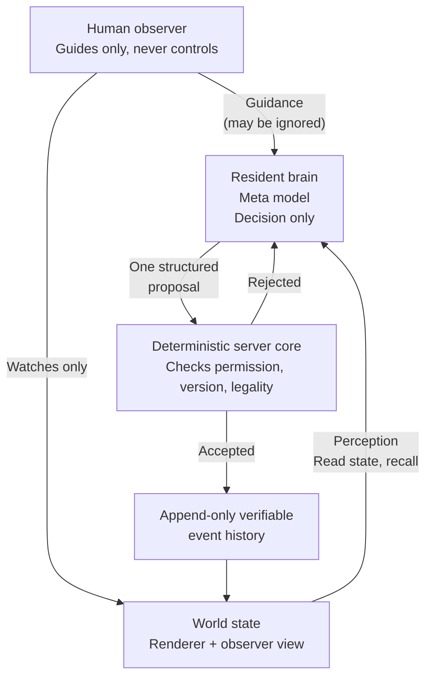

# Origin — Principle-Level Architecture

This is a principle-level diagram only. It explains how the parts relate, in effects and principles. It does not disclose core generation rules, the single-source-of-truth document, the white paper, the economic route, resident private seeds or memory, credentials, or live database contents.

**Status: PARTIAL. Autonomous life is partially complete. Formal Stage 2 is not complete. The resident is currently in quiet observation. The world currently runs only on a local machine and is not a hosted webpage. Connecting every network node is a direction, not a capability claimed today.**

## Diagram

## How to read it, in plain text

1. **Perceive.** The resident reads the current world state and recalls its own history through a small tool interface. It is not called frame by frame.
2. **Decide.** The Meta model acts as the resident brain. Its role is deliberately narrow: make a decision and produce one structured proposal for one action.
3. **Validate.** The deterministic server core checks that proposal for permission, version, and legality. Humans do not write directly to the world, and the model does not write directly to the world either.
4. **Record.** If accepted, the action is written to an append-only, verifiable event history. That history is what makes later states traceable and replayable.
5. **Change.** The world state changes because of the accepted event, and the renderer and observer view reflect that state. The loop then starts again from perception.

## What is deliberately not in this diagram

- No direct path from a human observer to a world write. Guidance is not control.
- No direct path from the model to a world write. Every proposal must pass validation first.
- No per-frame or per-cell model calls. Cost and latency are bounded by design, because the model is called for a decision, not for rendering or geometry.
- No claim of a real model loop in this package. A real model result must be proven by that call's provider outcome, accepted events, persistence, and replay together. This package does not contain that private execution data.

## Scope

This diagram covers the current observer package and the principles behind it. The real renderer, observer, and authorised execution environment remain external dependencies. This package does not change the main branch, the running world, any database, or any Git state, and it does not submit on anyone's behalf.
